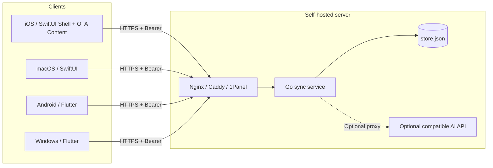
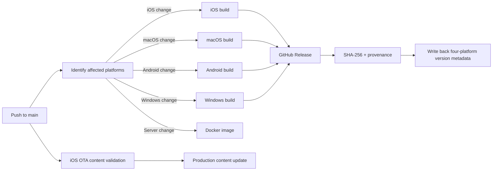

# Tempo system architecture

Tempo uses three client projects, one sync protocol, and one lightweight server. iOS combines a native SwiftUI shell with React Native/TypeScript content, while macOS remains SwiftUI. Android uses a separate Flowtime-derived Flutter project; Windows retains its own Flutter project. All clients share the Go server's JSON protocol.

Back to: [Documentation home](index.md) · [Product scope](PRODUCT.md) · [Design guidelines](DESIGN.md) · [Sync protocol](SYNC_PROTOCOL.md)

## System overview

## Clients

| Platform | Directory | UI technology | Local state | Secure storage |
| --- | --- | --- | --- | --- |
| iOS | `apps/apple` + `apps/ios-runtime` | SwiftUI, React Native, WidgetKit, ActivityKit | `AppStore` | Keychain |
| macOS | `apps/apple` | SwiftUI | `AppStore` | Keychain |
| Android | `apps/android` | Flutter | `AppProvider` | Hive / SharedPreferences |
| Windows | `apps/flutter` | Flutter, tray and window plugins | `TaskController` | `flutter_secure_storage` |

Tasks use JSON files in the platform's app-data directory. Device preferences such as appearance and module order remain local; tasks, Pomodoro, and RSS reading state enter the sync document.

iOS page content, styles, static assets, and routing built on existing native components can be updated over the air. Swift owns bottom navigation, top Liquid Glass buttons, permissions, widgets, Dynamic Island, and the data layer. Settings and Tools use the content layer's React Navigation native stack. See [iOS architecture and OTA](architecture/ios-ota.md) for the complete boundary.

### Apple extensions

The iOS app and `TEMPOWidgets` extension share minimal snapshots through the `group.one.darker.qingxu` App Group:

- WidgetKit reads snapshots of today's tasks and focus state.
- ActivityKit presents Pomodoro Live Activities on the Lock Screen and in Dynamic Island.
- Running countdowns store an absolute end time rather than relying on background execution every second.
- Extensions do not access sync directly; the main app writes state to the shared container.

## Local-first writes

Clients follow the same sequence when data changes:

1. Update in-memory state.
2. Persist locally using a temporary file and atomic replacement.
3. Refresh the interface and system-extension snapshots.
4. Sync ordinary edits after a roughly 100ms coalescing window; sync critical Pomodoro actions immediately.
5. Keep local edits after network failures and merge again when connectivity returns.

Creating, completing, and editing tasks therefore continue to work when the sync service is unavailable.

## Sync model

- **Tasks:** permanent identity by `id`, merged with last-write-wins using `updatedAt`; deletion tombstones win ties.
- **Pomodoro:** a singleton LWW document. Running state uses an absolute UTC `endsAt`; `phaseID` distinguishes consecutive phases. `dailyFocusGoal` and `focusHistory` support shared goals and heatmaps. Response `serverTime` corrects device clock offsets.
- **RSS:** a singleton LWW document containing subscriptions, folders, and article reading state. Article bodies are cached locally only.
- **Change notifications:** foreground clients wait for revision changes at `/v1/changes`, then call `/v1/sync`.
- **Fallback:** a full sync every five minutes supports reconnection; it does not replace change notifications.
- **Recovery:** clients persist the last revision, resume from it after restart, and reconnect with jittered exponential backoff.

This is document-level LWW, not a field-level CRDT. When two devices edit the same task concurrently, the complete task with the newer timestamp wins.

## Sync service

`services/sync` is a single-process Go HTTP service. Sync and authentication use the standard library; server pairing QR codes use a pinned version of `go-qrcode`:

- `GET /health`: check the process and data-directory writability.
- `GET /v1/ping`: validate the Bearer token.
- `POST /v1/sync`: merge atomically and return the complete sync state.
- `GET /v1/changes`: low-cost change notification with a maximum 25-second wait.
- `POST /v1/ai`: optional proxy for RSS summaries, translation, and task planning.

Persistence uses temporary files, `fsync`, and atomic replacement, writing to `/data/store.json` by default. The service is intended for one user and one instance. Multiple processes must not write the same file.

Docker defaults to a non-root user, a read-only root filesystem, dropped Linux capabilities, a process-count limit, and a 64 MiB memory limit. Nginx, Caddy, or 1Panel OpenResty provides public TLS.

## AI request paths

Clients support two modes:

1. **Self-hosted proxy:** the client calls `/v1/ai` using the sync address and token. Model credentials exist only in the server's `.env`.
2. **Direct client connection:** iOS/macOS call OpenAI, DeepSeek, or a compatible Chat Completions API directly, storing the API key in Keychain.

Both server and client include default prompts. Users choose a connection mode, provide the required credentials, and test the connection. AI failure does not affect tasks, local RSS, or sync.

## Release architecture

Public versions use only numeric `x.y.z` formatting. A release compiles affected platforms only; other platforms are not rebuilt. Clients select the most recent release containing their platform's assets. TypeScript OTA updates do not change the installed package version.

Public workflows generate unsigned iOS IPAs only. Personal certificates do not enter GitHub Actions; device installations use your own local signing process.

Documentation and client releases use independent workflows and do not block each other. Workflow implementations live in `.github/workflows`; user guides do not expose internal release details.
